# Repository Automations & Continuous Integration Manual

This document details the complete automation infrastructure configured in the **Meds Reminder** repository, covering remote CI/CD pipelines, local developer productivity scripts, git lifecycle hooks, dependency tracking, and in-app domain background automations.

---

## 1. Automation Architecture Overview

```mermaid
flowchart TD
    subgraph LocalEnv["Local Development Environment"]
        DevCode["Source Code Changes"] --> PrePush[".githooks/pre-push"]
        PrePush --> CheckScript["scripts/check.ps1"]
        CheckScript --> JBR["Auto-detect JDK 17 / Android Studio JBR"]
        JBR --> LocalTests["./gradlew testDebugUnitTest"]
    end

    subgraph GitHubActions["GitHub Actions Infrastructure"]
        Push["git push / PR to main"] --> CIWorkflow[".github/workflows/ci.yml"]
        CIWorkflow --> CIJob["Build, Lint & Unit Tests (JDK 17)"]

        TagPush["git push tag v*.*.*"] --> ReleaseWorkflow[".github/workflows/release.yml"]
        ReleaseWorkflow --> BuildAPK["./gradlew assembleRelease"]
        BuildAPK --> Checksums["Compute SHA-256 Checksums"]
        Checksums --> GHRelease["Publish Assets to GitHub Releases"]

        CronWeekly["Weekly (Mondays)"] --> Dependabot[".github/dependabot.yml"]
        Dependabot --> DepScan["Gradle Catalog (libs.versions.toml) & Actions"]
    end

    subgraph AppDomain["In-App Domain Automations"]
        Boot["Device Boot / Timezone Change"] --> BootRecv["BootReceiver (goAsync)"]
        BootRecv --> ExactAlarms["AlarmManager.setAlarmClock()"]
        Intake["Dosage State Transition"] --> GlanceRecv["Glance AppWidget Receivers"]
        GlanceRecv --> Widgets["Interactive HomeScreen Widgets"]
    end
```



---

## 2. Remote CI/CD Pipelines (GitHub Actions)

### 2.1. CI Quality Gate (`.github/workflows/ci.yml`)
* **Trigger Events:**
  * Pushes to `main` branch.
  * Pull requests targeting `main`.
* **Concurrency:** Automatically cancels redundant runs on the same branch or PR (`cancel-in-progress: true`).
* **Environment:** Ubuntu latest with JDK 17 (`actions/setup-java@v4`, Temurin distribution) and Gradle cache.
* **Execution Steps:**
  1. `chmod +x gradlew`: Grants execution permissions.
  2. `./gradlew testDebugUnitTest --continue`: Executes JVM unit test suites across all modules.
  3. `./gradlew lintDebug`: Runs Android Lint to detect resource leaks, missing translations, and API mismatches.
  4. `./gradlew assembleDebug`: Verifies compilation and assembly of the debug APK artifact.

### 2.2. Automated Release Pipeline (`.github/workflows/release.yml`)
* **Trigger Event:** Push of any semantic version tag matching `v*` (e.g. `v1.9.0`).
* **Execution Steps:**
  1. Executes test suite (`./gradlew testDebugUnitTest`).
  2. Assembles release binary (`./gradlew assembleRelease`).
  3. Renames the APK artifact to standard naming convention: `meds-reminder-vX.Y.Z-release.apk`.
  4. Computes SHA-256 cryptographic hash (`sha256sum`) and writes to `.apk.sha256`.
  5. Uses `softprops/action-gh-release@v2` with `contents: write` permissions to atomically attach the binary and checksum to the GitHub Release.

---

## 3. Automated Dependency Management (`.github/dependabot.yml`)

The repository integrates **GitHub Dependabot** with scheduled weekly execution (every Monday) targeting two independent ecosystems:
1. **`gradle`**: Monitors `gradle/libs.versions.toml` (AndroidX, Room, Jetpack Compose, Koin, Kotlin coroutines) for security advisories and version updates.
2. **`github-actions`**: Scans `.github/workflows/*.yml` for third-party action updates (e.g., `actions/checkout`, `actions/setup-java`, `softprops/action-gh-release`).

---

## 4. Local Development Scripts & Git Lifecycle Hooks

### 4.1. Local Quality Check Script (`scripts/check.ps1`)
On Windows workstations, the default `java.exe` in `PATH` may point to Java 8 or an incompatible JDK. `scripts/check.ps1` eliminates build friction by dynamically locating the Android Studio JetBrains Runtime (JBR) and setting `$env:JAVA_HOME` automatically before executing Gradle.

**Usage:**
```powershell
# Run both unit tests and Android lint checks
.\scripts\check.ps1

# Fast mode: Run unit tests only (skips lint)
.\scripts\check.ps1 -Fast

# Full verification: Run unit tests, lint, and assemble debug APK
.\scripts\check.ps1 -Build
```

### 4.2. Git Lifecycle Hooks (`.githooks/pre-push`)
* **Location:** `.githooks/pre-push`
* **Purpose:** Prevents developers from inadvertently pushing failing test suites or breaking regressions to remote branches.
* **Activation Command:**
  ```powershell
  .\scripts\setup-hooks.ps1
  # (Internally executes: git config core.hooksPath .githooks)
  ```
* **Behavior:** Automatically triggers `./scripts/check.ps1 -Fast` (or `./gradlew testDebugUnitTest` on POSIX environments) before allowing `git push`. If tests fail, the push is aborted immediately.

---

## 5. In-App Domain Background Automations

Beyond build-time and deployment automations, the application core features runtime system automations:

| Component | Trigger / Protocol | Operational Mechanism |
| :--- | :--- | :--- |
| **`BootReceiver`** | `BOOT_COMPLETED`, `MY_PACKAGE_REPLACED`, `TIME_SET`, `TIMEZONE_CHANGED`, `SCHEDULE_EXACT_ALARM_PERMISSION_STATE_CHANGED` | Reschedules all pending exact dosage alarms asynchronously using `goAsync()`, querying Room as SSOT without UI dependency. |
| **`AndroidAlarmScheduler`** | System `AlarmManager` | Schedules exact millisecond alerts using `AlarmManager.setAlarmClock()`, piercing Doze mode and App Standby buckets under medical exception (`USE_EXACT_ALARM`). |
| **`NotificationActionReceiver`** | Interactive notification actions (`Confirm`, `Snooze`, `Skip`) | Processes user interactions directly from lock screen banners, mutating Room state atomically and dismissing active audio/vibrations via `NotificationHelper.cancelAllForGroup()`. |
| **AppWidget Receivers** (`NextDoseWidgetReceiver`, `DailyScheduleWidgetReceiver`) | Database state mutations / `APPWIDGET_UPDATE` | Jetpack Glance `ActionCallback` handlers re-render interactive home screen widgets reactively without requiring the user to open `MainActivity`. |
| **Room Schema Generator** | Kotlin Symbol Processing (`ksp`) | Automatically dumps versioned database schemas to `app/schemas/com.medsreminder.data.local.AppDatabase/*.json` on every build to guarantee schema migration history. |
